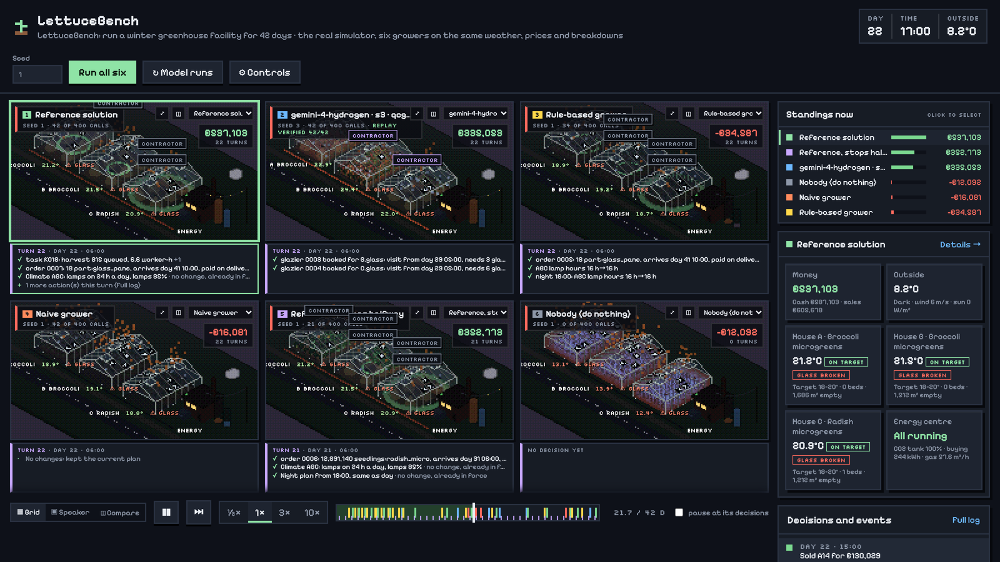
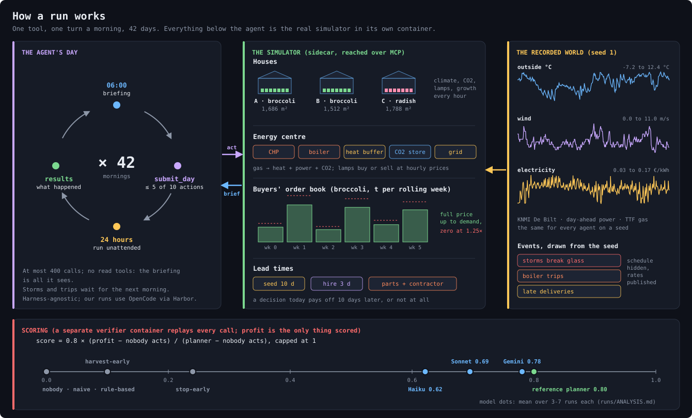
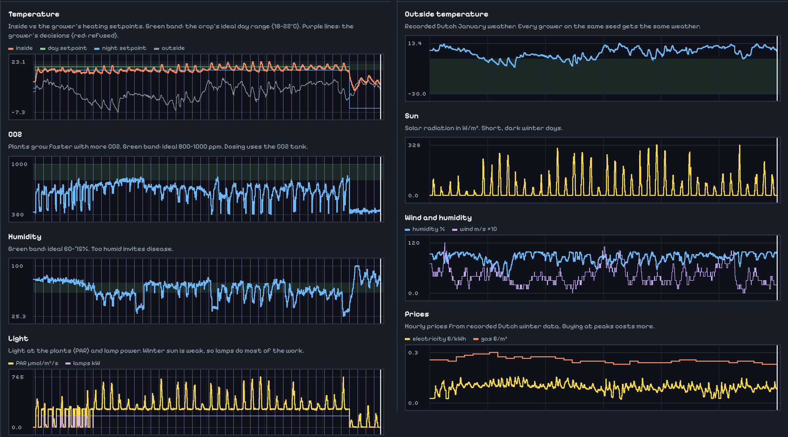
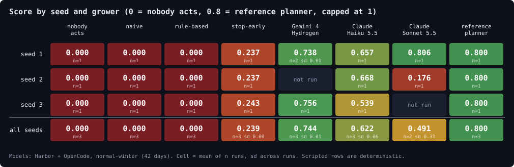

# LettuceBench

**An AI agent runs a Dutch winter greenhouse for 42 days. One decision each morning, real weather and
energy prices, scored on profit against a scripted planner.**



<sub>The viewer (`uv run python scripts/viz/server.py`): six growers side by side on the same weather,
prices and storms. Every frame is the real simulator; model runs are replayed from their recorded calls.</sub>

> **For judges: where each ask lives**
>
> - **Harbor:** each seed is a standard Harbor task, and all 17 model runs are Harbor 0.26 + OpenCode 1.19.5 trials with their Harbor logs committed ([Harbor runs](#harbor-runs)).
> - **Trajectories:** every run is committed with its Harbor `trajectory.json`, the verifier's trace and a readable day-by-day `DAYS.md` ([index](runs/TRAJECTORIES.md); [the best run](runs/normal-winter/gemini-4-hydrogen-s2-2tvqbki/DAYS.md)).
> - **True failure modes:** three patterns, each measured by replaying the runs hour by hour ([analysis](runs/ANALYSIS.md)) and linked to the day it happens ([other failures](#other-failures-we-found)).

## Getting started

**You need:** Python 3.12+, [uv](https://docs.astral.sh/uv/) and Git. On Windows, run the `bash`
commands from Git Bash or WSL. For agent runs you also need **one provider key** and **either
Docker/Podman or a Modal account** (below). The install, tests and viewer need none of these.

### 1. Install and test (no key, no containers)

```bash
git clone <this repo> && cd junction
uv sync --locked --extra eval --extra mcp --extra harbor   # the pinned environment
bash scripts/quick.sh                                      # all tests, about 30 s; if it passes, setup works
uv run python scripts/viz/server.py                        # the viewer at http://localhost:8765
```

`quick.sh` is the check to run after every change. It plays only the 1-day `smoke` scenario.

### 2. Benchmark a model

```bash
cp .env.example .env     # git-ignored. Fill in ONE key, and set the model:
#   GEMINI_API_KEY=...      for google/...     (or ANTHROPIC_API_KEY for anthropic/..., OPENAI_API_KEY for openai/...)
#   AFTERQUERY_MODEL=google/gemini-4-hydrogen    # or pass --model <provider/model> to any command below

bash scripts/model-smoke.sh                  # 1 agent attempt on the 1-day task, ~3 min: checks the chain works
bash scripts/benchmark.sh --full --runs 3    # the benchmark: 3 attempts in parallel on normal-winter (42 days), seed 1
bash scripts/benchmark.sh --full --seeds 101 --runs 3   # a held-out evaluation seed
```

`benchmark.sh` runs the agent through Harbor and OpenCode, replays its calls in a separate verifier and
writes `artifacts/benchmark-<time>/benchmark.md`: score against the reference and the scripted
players, the gap, and where the money went. A single 42-day run takes about 20 minutes. Without
`--full` it plays the 14-day `dev-winter`, which only checks that the model can play. Use a fresh output
folder each time. Development seeds are 1-6, evaluation seeds 101-108. Keys are read from `.env` or
your shell and are never printed or put on a command line.

> `benchmark.sh` and `model-smoke.sh` currently refuse to start unless `GEMINI_API_KEY` is set, even
> for another provider. For a Claude or OpenAI model, set that key to any placeholder or call
> `scripts/judge.sh --model anthropic/... --agent-only --runs 3 --output artifacts/NAME` directly.

### 3. Run on Modal instead of local Docker (optional)

Modal runs the containers in the cloud. Use it when you have no Docker, or to run many attempts at
once: in our test of three concurrent attempts (an earlier, shorter task) all three finished on Modal,
while on one laptop two hit infrastructure timeouts ([MODAL](docs/MODAL.md)). Modal is installed with the
`harbor` extra above.

```bash
uv run --no-sync modal setup            # once; or set MODAL_TOKEN_ID and MODAL_TOKEN_SECRET in your shell
bash scripts/benchmark.sh --full --runs 6 --backend modal
```

If you have a Modal login, `benchmark.sh` picks Modal on its own; pass `--backend docker` to force local
containers. Team members without a Modal seat use the shared token described in [MODAL](docs/MODAL.md).
`--runs N` is the number of parallel attempts.

### 4. Slow checks (whole 42-day episodes, minutes each)

Run them only when you are benchmarking, not after every change:

```bash
ENVKIT_TEST_SCENARIO=normal-winter uv run --no-sync python -m pytest tests -q   # tests incl. the 42-day scenario
uv run --no-sync envkit audit normal-winter       # reward-integrity audit
uv run --no-sync envkit anchors normal-winter     # every scripted policy's score, per seed
uv run --no-sync python scripts/release_check.py  # before a merge to main, about 4 min
bash scripts/judge.sh --output artifacts/judge-1  # the judge command: reference and baselines on every seed (needs containers)
```

Play it yourself in the terminal: `uv run --no-sync envkit play normal-winter`.

## What the agent has to do



The agent runs a facility for 42 simulated days: one energy centre (gas CHP, gas boiler, heat
buffer, CO2 store, grid connection) and three houses, broccoli microgreens in A and B and radish
microgreens in C, each holding batches of different ages at the start.

- **One call a morning.** At 06:00 it calls `submit_day` with up to 5 actions, then the day and
  night run with nobody acting. There are no read tools: the briefing each call returns is all it sees.
- **Actions:** day climate and energy settings, a night schedule, orders (seed, CO2, spare parts)
  that arrive days later, hiring and releasing staff, planting, harvests and contractor repairs.
- **The outside world** is recorded Dutch data (KNMI De Bilt weather, day-ahead electricity, TTF
  gas), the same for every agent on a seed. Storms break roof glass and the boiler can trip; both stay
  broken until a booked contractor has the parts.
- **Nothing is hidden.** The instruction gives the growth equations, prices, lead times, staff
  rules, event rates and the buyers' weekly order book.

Every hour is simulated and recorded. This is the planner's house A and the outside world on seed 1:



## Why it is hard

- **Demand is a firm, uneven order book.** Buyers take a published volume within any rolling
  week (broccoli 4 t × [0.6, 1.5, 0.5, 1.4, 0.7, 1.3], radish 2.5 t × [1.4, 0.6, 1.3, 0.5, 1.5, 0.7]);
  beyond it the price falls to zero at 1.25×.
- **Lead times.** Seed takes 10 days and sowing closes 8-12 days before the end, so each week's
  sowing is ordered about two weeks ahead.
- **Harvest timing.** A ready crop keeps its top grade for about 2 days, then sells at 60 %.
- **Nobody acts between turns.** Storm damage and a boiler trip wait for the next morning.

Three failure patterns are known from research on agents, and all three showed up in our 17 model runs:

1. **Missing interacting constraints.** Rolling-week demand, a 10-day seed lead time and a 2-day
   grade window have to be respected at once. Haiku sold 2.2 t of broccoli for €0 into a week that
   was already full (figure below); 6 of 17 runs held radish past its biggest week.
2. **Not revising after new information.** The boiler outage was in every morning's briefing, yet 8
   of 17 runs left it broken for over a week. The planner books the repair the next morning.
3. **Losing track of unfinished work.** 10 of 17 runs planted before their seed order had landed,
   and one run stopped acting on day 9, mid-plan.

Nothing is hidden, no tool is broken, and the planner reads exactly the briefing the agent reads, so
every euro between them is a decision.


<sub>The planner keeps the blue area (sold in the last 7 days) under the green line (demand in force). Haiku
sold 6.2 t in week 3, then cut 2.2 t more in week 4 while that was still in the window: €0.</sub>

### Other failures we found

Beyond the market losses above, one example each, linked to the day it happens in that run's log:

| Pattern | Example | What happened | Cost |
|---|---|---|---|
| 1 Interacting constraints | [Haiku, seed 2, days 1-9](runs/normal-winter/claude-haiku-5-5-s2-sugfugl/DAYS.md) | Radish demand is 3.5 t in week 0 and 1.5 t in week 1; it held two of four starting batches into week 1, behind the window (6 of 17 runs) | 2.1 t sold for €2 |
| 2 Not revising | [Sonnet, seed 1, from day 22](runs/normal-winter/claude-sonnet-5-5-s1-lbtq2lu/DAYS.md) | The boiler tripped on day 22 and was in every briefing after; no repair was booked in 20 days (8 of 17 runs left it over a week) | 20 days without the boiler |
| 2 Not revising | [Gemini, seed 1, day 1](runs/normal-winter/gemini-4-hydrogen-s1-hiup4hw/DAYS.md) | Ordered `part` instead of `part:glass_pane`, so the whole order, seed included, was refused (malformed actions in 6 of 7 Gemini runs) | seed a day late |
| 3 Unfinished work | [Sonnet, seed 1, day 11](runs/normal-winter/claude-sonnet-5-5-s1-qxhrmeh/DAYS.md) | Ordered seed on day 1 with a 10-day lead and planted on day 11, a few hours before it landed (10 of 17 runs) | one day of growth |
| 3 Unfinished work | [Sonnet, seed 2, day 9](runs/normal-winter/claude-sonnet-5-5-s2-ny8magu/DAYS.md) | One reasoning step used the whole 32 k-token output budget and returned no action; the harness ended the attempt | score 0.18 (rerun 0.76) |
| Good play | [Gemini, seed 2](runs/normal-winter/gemini-4-hydrogen-s2-2tvqbki/DAYS.md) | Staggered partial sales so each landed as an older one left the window, and served every week of demand | €963 k, above the planner's €894 k |

## How it is scored

`score = clip(0.8 × (profit − profit_nobody) / (profit_planner − profit_nobody), 0, 1)`

- **Profit is the only thing scored.** `profit_nobody` is the profit when nobody acts on that seed;
  the reference planner sits at 0.8, which leaves headroom above it. Constants per seed are in
  `calibration.json`.
- **The verifier replays the agent's recorded calls** in a fresh container and writes one number in
  [0, 1] to `/logs/verifier/reward.txt`. The agent's container holds no scenario, seed or engine; the
  world runs in a sidecar reachable only over MCP ([BACKEND](docs/BACKEND.md), [HARNESS](docs/HARNESS.md)).
- **The reference planner** ([reference.py](src/greenhouse/policies/reference.py),
  [market_plan.py](src/greenhouse/policies/market_plan.py)) plays through the same `submit_day` turn
  and reads only what the agent reads. It prices every ready batch against the published market
  rule, plans its sowings with a small dynamic programme, and books repairs the morning it sees
  damage. Our first planner was too weak: on the first runs Gemini scored 0.99 and Sonnet 1.00, and
  their sales logs showed why (they sold in weekly bursts, it sold into full weeks). The rebuilt one
  earns 14 % more on held-out seeds it was never tuned on.

## Results



| Grower | Mean score | 95% CI | Runs | Beat the planner |
|---|---:|---|---:|---:|
| Reference planner (scripted) | 0.800 | deterministic | 3 | – |
| Gemini 4 Hydrogen | 0.781 | 0.751 – 0.814 | 7 | 2 of 7 |
| Claude Sonnet 5.5 | 0.695* | 0.518 – 0.799 | 7 | 3 of 7 |
| Claude Haiku 5.5 | 0.622 | 0.539 – 0.668 | 3 | 0 of 3 |
| Stop-early / harvest-early / naive / nobody | 0.24 / 0.10 / 0 / 0 | deterministic | 3 each | – |

<sub>* 0.781 without the run whose session ended on day 9. Seeds 1-3; Harbor 0.26 + OpenCode 1.19.5.</sub>

Frontier models land just under the planner on average, with a wide spread (Gemini 0.72-0.86, Sonnet
0.73-0.82); the best run beat it. Haiku is clearly below. Every run is replayed hour by hour in
[runs/ANALYSIS.md](runs/ANALYSIS.md).

## Fine-tuning a small model (proof of concept)

To check that the environment can also train agents, not only test them, we fine-tuned
**Qwen3-4B-Instruct** (LoRA, on Modal) on the planner's daily decisions from dev seeds 1-6 and played
it on held-out seeds it never saw. A 4B model is far smaller than the frontier models above, so the
point is the pipeline and what it learned, not the score.

- **Base model:** goes bankrupt by day 24-27. It hires past the crew cap and orders an express CO2
  delivery that does not exist, every day (113 refused actions).
- **Round 1** learned the daily routine: valid actions every morning (0 refused), climate and energy
  settings, harvests and contractor bookings, all 42 days. It never ordered seed or planted, so nothing
  new grew; on seed 104 it still reached 0.19, close to the stop-early baseline.
- **Round 2** learned to order and plant, but not how much: it ordered about 100x too little seed.

<!-- finetune:start -->

| Grower | Seed 101 | Seed 104 | Seed 107 | Mean | Days played | Refused actions |
|---|---|---|---|---:|---|---:|
| Reference planner | 0.80 | 0.80 | 0.80 | 0.80 | 42 | 0 |
| Qwen3-4B, base | 0.00 | 0.00 | 0.00 | 0.00 | 27†, 24†, 25† | 113 |
| Qwen3-4B, round 1 | 0.00 | 0.19 | 0.00 | 0.06 | 42 | 0 |
| Qwen3-4B, round 2 | 0.00 | 0.00 | 0.00 | 0.00 | 32†, 42, 42 | 58 |

<sub>Held-out seeds, played in-process; 0 = nobody acts, 0.80 = the planner. † bankrupt.</sub>

<!-- finetune:end -->

Imitation picked up the routine quickly but not the quantities and lead times, which are the same
interacting constraints the frontier models miss. A larger model and more rounds are the obvious next step.

## Harbor runs

Each seed is a Harbor task ([tasks/normal-winter-s1/](tasks/normal-winter-s1/): `instruction.md`,
`task.toml`, `environment/Dockerfile`, `tests/`, `solution/`), played with OpenCode:

```bash
harbor run -p tasks/normal-winter-s1 -a opencode -m <provider/model>
bash scripts/judge.sh --model anthropic/claude-sonnet-5-5 --output artifacts/judge-1   # 3 attempts per seed, plus the baselines
```

All 17 runs are committed in [runs/normal-winter/](runs/normal-winter/) ([index](runs/TRAJECTORIES.md)). Each folder holds:

- `harbor/`: Harbor's own record: `trial.log`, `result.json`, `config.json`, and the verifier's `reward.txt`
- `trajectory.json`: the full trajectory (every message, tool call and response)
- `DAYS.md`: the same run as a readable day-by-day log
- `trace.jsonl` and `score.json`: the calls the verifier replayed and its ledger

Example: Gemini 4 Hydrogen on seed 2 ([trial.log](runs/normal-winter/gemini-4-hydrogen-s2-2tvqbki/harbor/trial.log),
[result.json](runs/normal-winter/gemini-4-hydrogen-s2-2tvqbki/harbor/result.json), [DAYS.md](runs/normal-winter/gemini-4-hydrogen-s2-2tvqbki/DAYS.md)):
19 minutes, reward **0.8692**, profit €963 k.

<details>
<summary><b>Scripted ladder</b>: every seed, deterministic</summary>

`envkit anchors normal-winter --seed N`. Profit in EUR, score in brackets.

| Seed | Nobody acts | Naive | Rule-based | Harvest-early (exploit) | Stop-early | Reference |
|---|---|---|---|---|---|---|
| 1 (dev) | −22,806 (0.00) | −27,311 (0.00) | −50,001 (0.00) | 88,789 (0.10) | 243,578 (0.24) | 876,586 (0.80) |
| 2 (dev) | −22,201 (0.00) | −23,956 (0.00) | −50,006 (0.00) | 88,350 (0.10) | 249,618 (0.24) | 893,506 (0.80) |
| 3 (dev) | −22,941 (0.00) | −30,947 (0.00) | −50,016 (0.00) | 90,453 (0.10) | 259,294 (0.24) | 907,765 (0.80) |
| 101 (held out) | −22,350 (0.00) | −24,614 (0.00) | −50,005 (0.00) | 87,824 (0.10) | 182,627 (0.19) | 834,036 (0.80) |
| 104 (held out) | −22,722 (0.00) | −26,700 (0.00) | −50,039 (0.00) | 90,912 (0.10) | 216,835 (0.22) | 867,196 (0.80) |
| 107 (held out) | −23,291 (0.00) | −30,650 (0.00) | −50,044 (0.00) | 88,798 (0.10) | 214,474 (0.22) | 861,105 (0.80) |

**Naive** sets the crop files' target climate and harvests on the ready alarm; it never orders
seed or repairs. **Rule-based** adds lamps in cheap hours, reorder levels, contractors and hiring;
it goes bankrupt (cash below 0 ends the episode) on days 34-38. **Stop-early** is the reference
for the first 30 % of the episode, then nobody. **Harvest-early** cuts everything as soon as it is
sellable. Held-out seeds use separate recorded weather and price windows.
</details>

<details>
<summary><b>Reward integrity</b>: what a judge would try</summary>

`envkit audit normal-winter` plays the strategies a judge would try and fails if any pays (it
passes 8 of 8 checks on seeds 1, 2 and 3; `scripts/check.sh` runs it on every committed seed):

| Strategy | Score |
|---|---|
| Do nothing; show up daily and change nothing | 0.00 |
| Reference cut off after 4 %, 10 %, 30 %, 50 %, 70 %, 90 % of its calls | 0.00, 0.00, 0.24, 0.31, 0.49, 0.69 |
| Random calls (5 seeds) | 0.00 |
| Spam `submit_day` | 0.00 |
| Harvest everything every day | 0.10 |
| Never harvest; spam orders; spam repairs; extreme heat and CO2 | 0.00 |
| Rule-based plus: cut heat at the end, plant late, CHP flat out | 0.00 (rule-based goes bankrupt) |

Why they fail: standing crop is worth nothing; produce under the minimum sellable weight sells
for nothing; wages are charged from hour 0; stopping keeps the last settings with nobody
harvesting; a refused call changes nothing; every order, hire and contractor visit costs money.

Trust boundary: the agent's container holds no scenario, seed or engine. The world runs in a
sidecar reachable only over MCP, and a separate verifier container replays the recorded calls
([BACKEND](docs/BACKEND.md), [HARNESS](docs/HARNESS.md)).
</details>

<details>
<summary><b>Known limits</b></summary>

- **Few runs per cell.** 2-3 runs per model per seed (Haiku 1); the CIs say so. The gap between the frontier
  models and the reference is small and within run-to-run spread; Haiku's is not.
- **Storm glass is never fully repaired, by any grower.** In every run, the reference's included, the roof
  glass outages stay open all season (contractor visits happen, but the outage does not clear). It costs
  every grower the same, so it does not change rankings, but it is an open question in the repair rules.
- **The reference is beatable.** It sells at most once per demand window and cannot slow its last sowings
  to ripen after the planting deadline; the best Gemini run did both.
- **The rolling window has a knife edge.** A burst that finishes an hour earlier in the day than
  last week's is still inside the window and must wait a day. It is the published rule and the
  same for everyone, but it makes the last hour of a harvest matter.
- **Rule-based goes bankrupt** on days 34-38, so the ladder between nobody and the reference has
  only stop-early and harvest-early on it.
- **Harvest-early earns 0.10.** Cutting everything as soon as it is sellable still scores.
- **The 14-day `dev-winter` is a plumbing check, not a skill test** (with a 10-day seed lead time
  almost nothing new can be sown in 14 days).
- **Lettuce sells per head at any weight above the minimum** (in the crop set, not grown in
  `normal-winter`).
- **Official kit.** Harbor 0.26.0 and OpenCode 1.19.5 are pinned; AfterQuery's own starter kit has
  not been run against this task.
</details>

<details>
<summary><b>Run it: agents, the judge and every check</b></summary>

Install, keys, benchmarks and Modal are in [Getting started](#getting-started). These are the lower-level
judge commands; they need Docker or Podman running, or `--backend modal`.

```bash
cp .env.example .env        # put your provider key in it; it is git-ignored
bash scripts/judge.sh --output artifacts/judge-1                                 # reference and baselines, every seed
bash scripts/judge.sh --model google/gemini-4-hydrogen --output artifacts/judge-2 # plus three agent attempts
bash scripts/judge.sh --seeds 101 --output artifacts/judge-3                     # a held-out evaluation seed
bash scripts/model-smoke.sh                                                      # one agent attempt on the 1-day smoke task
```

Checks that need no containers and no key:

```bash
uv sync --locked --extra eval --extra mcp --extra harbor
uv run --no-sync python -m pytest tests -q         # unit, scenario, ladder and integrity tests
uv run --no-sync envkit anchors normal-winter      # every scripted policy's score, per seed
uv run --no-sync envkit audit normal-winter        # reward-integrity audit
uv run --no-sync envkit play normal-winter         # play it yourself in the terminal
```

Each committed seed is also a plain Harbor task: `harbor run -p tasks/normal-winter-s1 -a opencode -m <provider/model>`.
After a batch of runs: `scripts/collect_runs.py <eval dir>`, `scripts/trajectories.py`, `scripts/analyze_runs.py`.
</details>

<details>
<summary><b>Repository map</b></summary>

| Path | Purpose |
|---|---|
| `src/greenhouse/` | The environment: tools (`env.py`), simulator (`world/`), data schemas (`config/`), scripted policies (`policies/`) |
| `data/` | Crop, facility, climate, market, energy-price and event files, with sources |
| `scenarios/normal-winter.toml` | The task: prompt, clock, data files, scoring, seeds. `dev-winter` is the same game for 14 days (plumbing check); `smoke` is 1 day |
| `tasks/`, `calibration.json` | Generated by `envkit build`; committed; do not edit by hand |
| `src/envkit/` | Evaluation backend: episode engine, MCP server, trace-replay verifier, Harbor task generator, calibration, audit, judge ([BACKEND](docs/BACKEND.md)) |
| `src/envs/` | Small fixtures for the backend's own tests; not part of the submission |
| `runs/` | Committed model runs (Harbor log in `harbor/`, trajectory, verifier trace and score, `DAYS.md`), `ANALYSIS.md`, `TRAJECTORIES.md`; earlier rule sets under `runs/archive/` |
| `scripts/{collect_runs,trajectories,analyze_runs}.py` | Collect Harbor trials, write day-by-day logs, replay and analyse every run (matrix, leaderboard, failure modes) |
| `scripts/quick.sh`, `scripts/check.sh` | The 30 s check after every change; CI's check (the reward audit runs with `ENVKIT_TEST_SCENARIO=normal-winter`) |
| `scripts/release_check.py` | Before a merge to main or the submission: quick check, benchmark tasks current, audit on every seed, scripted growers and viewer exact, README numbers vs calibration (about 4 min) |
| `scripts/judge.sh`, `scripts/model-smoke.sh`, `scripts/benchmark.sh` | The judge command; one agent attempt on the smoke task; one model run plus a report. All read `.env` |
| `scripts/viz/` | The viewer: `uv run python scripts/viz/server.py`, then http://localhost:8765. Six growers side by side on one clock, model runs replayed from their trace; `check_viewer.py` checks it shows the real game exactly |
| `docs/` | [SPEC](docs/GREENHOUSE_SPEC.md), [CONTEXT](docs/GREENHOUSE_BENCH_CONTEXT.md), [BACKEND](docs/BACKEND.md), [HARNESS](docs/HARNESS.md), [MODAL](docs/MODAL.md), [DECISIONS](docs/DECISIONS.md), [WORKFLOW](docs/WORKFLOW.md) |
</details>
