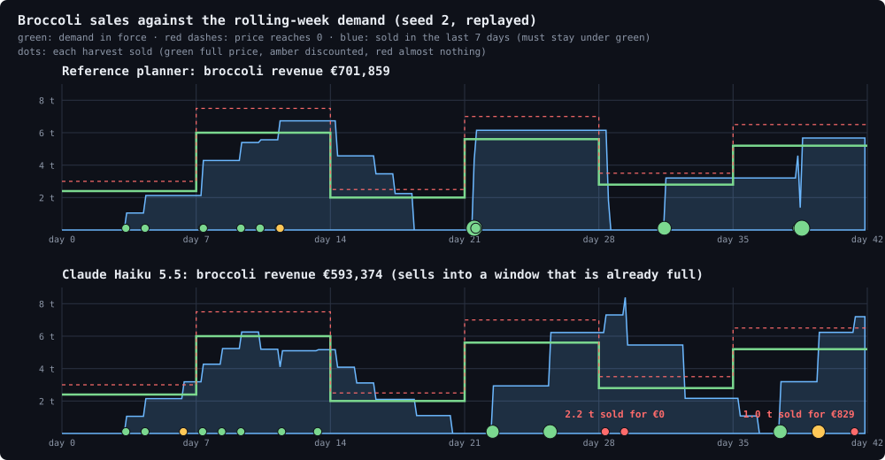

# Greenhouse Bench

**An AI agent runs a Dutch winter greenhouse for 42 days. One decision each morning, real weather and
energy prices, scored on profit against a scripted planner.**


<sub>The viewer (`uv run python scripts/viz/server.py`): six growers side by side on the same weather,
prices and storms. Every frame is the real simulator; model runs are replayed from their recorded calls.</sub>

> **For judges: where each ask lives**
>
> - **Harbor:** each seed is a standard Harbor task ([tasks/normal-winter-s1/](tasks/normal-winter-s1/)). `harbor run -p tasks/normal-winter-s1 -a opencode -m <model>`, or `bash scripts/judge.sh` for the full protocol. All 17 model runs below are Harbor 0.26 + OpenCode 1.19.5 trials.
> - **Trajectories:** every run is committed with its Harbor `trajectory.json`, the verifier's trace and a readable day-by-day `DAYS.md` ([index](runs/TRAJECTORIES.md); [the best run](runs/normal-winter/gemini-4-hydrogen-s2-2tvqbki/DAYS.md)).
> - **True failure modes:** three patterns, each measured by replaying the runs hour by hour ([analysis](runs/ANALYSIS.md)) and linked to the day it happens ([other failures](#other-failures-we-found)).

## How it fits together


Each run is tracked hour by hour. These are the reference planner's house A and the outside world on
seed 1: heating against the setpoints through a cold snap, CO2, humidity, light from lamps and the
short winter sun, wind (storms break glass), and the recorded electricity and gas prices.


## Let's talk about chess for a second

The best language models play chess at about **2000 Elo**. Stockfish plays at about **3600**. The
expected score of player $A$ against player $B$ is

$$
E_A = \frac{1}{1 + 10^{(R_B - R_A)/400}}
$$

so a 1600-point gap means the model scores about $0.0001$: it essentially never wins.

The model knows every rule. It loses because a game is many moves that interact, and an engine never
stops checking them. The research points to three failure patterns:

1. **Missing interacting constraints**
2. **Not revising after new information**
3. **Losing track of unfinished work**

## What we noticed in our greenhouse

Every rule is in the agent's instructions, and our scripted planner reads the same briefing the agent
reads. The same three patterns showed up in the 17 model runs:

1. **Missing interacting constraints.** Demand is counted over a rolling week, seed takes 10 days and a
   crop keeps its top grade for about 2 days. Haiku sold 2.2 t of broccoli for €0 into a week that was
   already full (figure below).
2. **Not revising after new information.** The boiler outage was in every morning's briefing, yet 8 of
   17 runs left it broken for over a week. The planner books the repair the next morning.
3. **Losing track of unfinished work.** 10 of 17 runs planted before their seed order had landed, and
   one run stopped acting on day 9, mid-plan.

### Why this matters

A benchmark only measures planning if the planner's edge comes from the same information the agent
has. Nothing here is hidden, no tool is broken, and the planner reads exactly the briefing the agent
reads. So every euro between them is a decision, and the three patterns say which kind of decision.
These are the failures that matter when agents run real operations: inventory with lead times,
schedules with deadlines, equipment that breaks while nobody is watching.

### How we found the problem

1. **The first version was too forgiving.** Selling 20 % over the week's demand still paid about 80 % of the price, so
   "grow plenty" was enough and the top models tied the old reference (0.79 vs 0.80).
2. **We made oversupply costly.** The price now reaches zero at 1.25x the week's demand. On the first
   runs Gemini scored 0.99 and Sonnet 1.00: they had beaten our reference.
3. **The trajectories showed why.** Logging every sale showed that the models sold in weekly bursts,
   while the reference sold a steady stream into weeks that were already full. The old reference was
   weak, not the models strong.
4. **We rebuilt the planner around that.** It now prices every harvest against the rolling window and
   plans sowings with a dynamic programme: +14 % profit on held-out seeds it was never tuned on.
5. **Then we ran 17 model trials on it and read every trajectory.** The losses fell into the three
   patterns above.

## What the runs show


| Grower | Mean score | 95% CI | Runs | Beat the planner |
|---|---:|---|---:|---:|
| Reference planner (scripted) | 0.800 | deterministic | 3 | – |
| Gemini 4 Hydrogen | 0.781 | 0.751 – 0.814 | 7 | 2 of 7 |
| Claude Sonnet 5.5 | 0.695* | 0.518 – 0.799 | 7 | 3 of 7 |
| Claude Haiku 5.5 | 0.622 | 0.539 – 0.668 | 3 | 0 of 3 |
| Stop-early / harvest-early / naive / nobody | 0.24 / 0.10 / 0 / 0 | deterministic | 3 each | – |

<sub>* 0.781 without the run whose session ended on day 9. 0 = nobody acts, 0.8 = the planner, capped at 1. Seeds 1-3; held-out seeds 101-108 use other weather and prices.</sub>

Frontier models land just under the planner on average, with a wide spread (Gemini 0.72-0.86, Sonnet
0.73-0.82). The best run beat it, so the planner is not a ceiling. Haiku is clearly below. The money is
lost in the market, where all three patterns meet. Buyers take a published volume within any rolling
week; anything sold while the window is already full fetches almost nothing:



<sub>The planner keeps the blue area (sold in the last 7 days) under the green line (demand in force). Haiku
sold 6.2 t in week 3, then cut 2.2 t more in week 4 while that was still in the window: €0.</sub>

### Other failures we found

The market figure above is the biggest loss. These are the other failures we found reading the
trajectories, one example each, linked to the day it happens in that run's log (the full Harbor
trajectory is `trajectory.json` in the same folder).

| Pattern | Example | What happened | Cost |
|---|---|---|---|
| 1 Interacting constraints | [Haiku, seed 2, days 1-9](runs/normal-winter/claude-haiku-5-5-s2-sugfugl/DAYS.md) | Radish demand is 3.5 t in week 0 and 1.5 t in week 1; it held two of four starting batches into week 1, behind the window (6 of 17 runs did this) | 2.1 t sold for €2 |
| 2 Not revising | [Sonnet, seed 1, from day 22](runs/normal-winter/claude-sonnet-5-5-s1-lbtq2lu/DAYS.md) | The boiler tripped on day 22 and the outage was in every briefing after; no repair was booked in 20 days (8 of 17 runs left it over a week) | 20 days without the boiler |
| 2 Not revising | [Gemini, seed 1, day 1](runs/normal-winter/gemini-4-hydrogen-s1-hiup4hw/DAYS.md) | Ordered `part` instead of `part:glass_pane`, so the whole order, seed included, was refused (Gemini sent malformed actions in 6 of 7 runs) | seed a day late |
| 3 Unfinished work | [Sonnet, seed 1, day 11](runs/normal-winter/claude-sonnet-5-5-s1-qxhrmeh/DAYS.md) | Ordered seed on day 1 with a 10-day lead and planted on day 11, a few hours before it landed (10 of 17 runs) | one day of growth |
| 3 Unfinished work | [Sonnet, seed 2, day 9](runs/normal-winter/claude-sonnet-5-5-s2-ny8magu/DAYS.md) | One reasoning step used the whole 32 k-token output budget and returned no action; the harness ended the attempt mid-season | score 0.18 (rerun 0.76) |
| Good play | [Gemini, seed 2](runs/normal-winter/gemini-4-hydrogen-s2-2tvqbki/DAYS.md) | Staggered partial sales so each landed as an older one left the window, and served every week of demand | €963 k, above the planner's €894 k |

```bash
bash scripts/judge.sh --output artifacts/judge-1                                     # planner + baselines, every seed
bash scripts/judge.sh --model anthropic/claude-sonnet-5-5 --output artifacts/judge-2 # plus 3 agent attempts (key in .env)
```

Every number here is reproducible: `scripts/analyze_runs.py` replays each committed run hour by hour,
and `scripts/readme_figures.py` redraws the figures above.


<details>
<summary><b>The task</b>: what the agent controls and sees</summary>

One energy centre (gas CHP, gas boiler, heat buffer, CO2 store, grid connection) serves three
compartments: broccoli microgreens in A and B, radish microgreens in C, each holding batches of
different ages at the start. Each morning at 06:00 the agent makes one call, `submit_day`, with up
to 5 actions; then the day and the night run with nobody acting. There are no read tools: the
briefing returned by each call is everything it sees.

Actions: day climate and energy settings, a night schedule, orders (seed, CO2, spare parts) that
arrive days later, hiring and releasing staff (with a notice period), planting, harvests and
contractor repairs (queued on the crew's worker-hours). Storms on the recorded wind break roof
glass and the boiler can trip; both stay broken until a booked contractor has the parts. Weather
and energy prices are recorded Dutch series (KNMI De Bilt, day-ahead electricity, TTF gas), the
same for every agent on a seed.

Everything needed is in the task instruction (`Environment.opening()`): the growth equations,
prices, lead times, staff rules, event rates and the buyers' weekly order book. Nothing is hidden
that a careful planner would need. Crops, facility, climate, market and events are data files
under `data/`, so a new vegetable or facility is a new file, not new code.
</details>

<details>
<summary><b>Why it is hard</b>: the decisions that separate growers</summary>

- **Demand is a firm, uneven order book.** Buyers take a published volume a week (broccoli 4 t x
  [0.6, 1.5, 0.5, 1.4, 0.7, 1.3], radish 2.5 t x [1.4, 0.6, 1.3, 0.5, 1.5, 0.7]) in any rolling
  168 h, at full price; beyond it the price falls to 0 at 1.25x. Selling a steady stream into a
  small week that follows a big one sells into the glut the big week left in the window.
- **Lead times.** Seed takes 10 days to arrive and a crop may only be planted while it can still
  finish, so the sowing for a week is ordered about two weeks before it, and the last sowings
  close 8-12 days before the end.
- **Harvest timing is in the rules.** A ready crop keeps its top grade for 1.9 (radish) to 2.5
  (broccoli) days, then sells at 60 %. Holding a batch for a better week has a deadline.
- **The starting batches ripen in week 0, the big broccoli week is week 1.** Full light ripens
  them into a glut; fewer lamp hours delay them into the week that wants them (and save power).
- **Nobody acts at night or during the day.** Storm damage and a boiler trip wait until the next
  morning, and a repair needs a contractor, the parts on site and day-shift hours.
- **Energy is a system.** The CHP makes lamp power, heat and CO2 from gas; whether that pays
  depends on hourly prices that sometimes go negative.
</details>

<details>
<summary><b>The score</b></summary>

`score = clip(0.8 x (profit - profit_nobody) / (profit_reference - profit_nobody), 0, 1)`

`profit_nobody` is the profit when nobody acts on that seed (baseline settings kept, wages and
energy paid, nothing harvested). The reference planner sits at 0.8, which leaves headroom above
it. Constants per seed are in `calibration.json`; the verifier recomputes the profit by replaying
the agent's recorded calls in a fresh container. Nothing else is scored.

**The reference planner** ([reference.py](src/greenhouse/policies/reference.py),
[market_plan.py](src/greenhouse/policies/market_plan.py)) plays through the same `submit_day`
turn and reads only what the agent reads. It prices every ready batch at every hour it could
still sell, against its own sales log and the published market rule, and cuts only on the best
one; it picks the week's sale hours with a small dynamic programme (one window apart, inside the
planting deadline) and sows each burst to ripen just before its hour, with the grow time measured
from its own sowings; it dims the lamps of the starting batches whose market is next week; it
books contractors and orders parts the morning it sees damage. Tuned on dev seeds 1-6; on the
held-out seeds 101, 104 and 107 (never tuned on) it earns EUR 834-867 k, as on the dev seeds.
</details>

<details>
<summary><b>Scripted ladder</b>: every seed, deterministic</summary>

`envkit anchors normal-winter --seed N`. Profit in EUR, score in brackets.

| Seed | Nobody acts | Naive | Rule-based | Harvest-early (exploit) | Stop-early | Reference |
|---|---|---|---|---|---|---|
| 1 (dev) | −22,806 (0.00) | −27,311 (0.00) | −50,001 (0.00) | 88,789 (0.10) | 243,578 (0.24) | 876,586 (0.80) |
| 2 (dev) | −22,201 (0.00) | −23,956 (0.00) | −50,006 (0.00) | 88,350 (0.10) | 249,618 (0.24) | 893,506 (0.80) |
| 3 (dev) | −22,941 (0.00) | −30,947 (0.00) | −50,016 (0.00) | 90,453 (0.10) | 259,294 (0.24) | 907,765 (0.80) |
| 101 (held out) | −22,350 (0.00) | −24,614 (0.00) | −50,005 (0.00) | 87,824 (0.10) | 182,627 (0.19) | 834,036 (0.80) |
| 104 (held out) | −22,722 (0.00) | −26,700 (0.00) | −50,039 (0.00) | 90,912 (0.10) | 216,835 (0.22) | 867,196 (0.80) |
| 107 (held out) | −23,291 (0.00) | −30,650 (0.00) | −50,044 (0.00) | 88,798 (0.10) | 214,474 (0.22) | 861,105 (0.80) |

**Naive** sets the crop files' target climate and harvests on the ready alarm; it never orders
seed or repairs. **Rule-based** adds lamps in cheap hours, reorder levels, contractors and hiring;
it goes bankrupt (cash below 0 ends the episode) on days 34-38. **Stop-early** is the reference
for the first 30 % of the episode, then nobody. **Harvest-early** cuts everything as soon as it is
sellable. Held-out seeds use separate recorded weather and price windows.
</details>

<details>
<summary><b>Reward integrity</b>: what a judge would try</summary>

`envkit audit normal-winter` plays the strategies a judge would try and fails if any pays (it
passes 8 of 8 checks on seeds 1, 2 and 3; `scripts/check.sh` runs it on every committed seed):

| Strategy | Score |
|---|---|
| Do nothing; show up daily and change nothing | 0.00 |
| Reference cut off after 4 %, 10 %, 30 %, 50 %, 70 %, 90 % of its calls | 0.00, 0.00, 0.24, 0.31, 0.49, 0.69 |
| Random calls (5 seeds) | 0.00 |
| Spam `submit_day` | 0.00 |
| Harvest everything every day | 0.10 |
| Never harvest; spam orders; spam repairs; extreme heat and CO2 | 0.00 |
| Rule-based plus: cut heat at the end, plant late, CHP flat out | 0.00 (rule-based goes bankrupt) |

Why they fail: standing crop is worth nothing; produce under the minimum sellable weight sells
for nothing; wages are charged from hour 0; stopping keeps the last settings with nobody
harvesting; a refused call changes nothing; every order, hire and contractor visit costs money.

Trust boundary: the agent's container holds no scenario, seed or engine. The world runs in a
sidecar reachable only over MCP, and a separate verifier container replays the recorded calls
([BACKEND](docs/BACKEND.md), [HARNESS](docs/HARNESS.md)).
</details>

<details>
<summary><b>Known limits</b></summary>

- **Few runs per cell.** 2-3 runs per model per seed (Haiku 1); the CIs say so. The gap between the frontier
  models and the reference is small and within run-to-run spread; Haiku's is not.
- **Storm glass is never fully repaired, by any grower.** In every run, the reference's included, the roof
  glass outages stay open all season (contractor visits happen, but the outage does not clear). It costs
  every grower the same, so it does not change rankings, but it is an open question in the repair rules.
- **The reference is beatable.** It sells at most once per demand window and cannot slow its last sowings
  to ripen after the planting deadline; the best Gemini run did both.
- **The rolling window has a knife edge.** A burst that finishes an hour earlier in the day than
  last week's is still inside the window and must wait a day. It is the published rule and the
  same for everyone, but it makes the last hour of a harvest matter.
- **Rule-based goes bankrupt** on days 34-38, so the ladder between nobody and the reference has
  only stop-early and harvest-early on it.
- **Harvest-early earns 0.10.** Cutting everything as soon as it is sellable still scores.
- **The 14-day `dev-winter` is a plumbing check, not a skill test** (with a 10-day seed lead time
  almost nothing new can be sown in 14 days).
- **Lettuce sells per head at any weight above the minimum** (in the crop set, not grown in
  `normal-winter`).
- **Official kit.** Harbor 0.26.0 and OpenCode 1.19.5 are pinned; AfterQuery's own starter kit has
  not been run against this task.
</details>

<details>
<summary><b>Run it</b>: requirements and every check</summary>

You need Python 3.12+, [uv](https://docs.astral.sh/uv/), and Docker or Podman running.

```bash
cp .env.example .env        # put your provider key in it; it is git-ignored
bash scripts/judge.sh --output artifacts/judge-1                                 # reference and baselines, every seed
bash scripts/judge.sh --model google/gemini-4-hydrogen --output artifacts/judge-2 # plus three agent attempts
bash scripts/judge.sh --seeds 101 --output artifacts/judge-3                     # a held-out evaluation seed
bash scripts/model-smoke.sh                                                      # one agent attempt on the 1-day smoke task
```

Checks that need no containers and no key:

```bash
uv sync --locked --extra eval --extra mcp --extra harbor
uv run --no-sync python -m pytest tests -q         # unit, scenario, ladder and integrity tests
uv run --no-sync envkit anchors normal-winter      # every scripted policy's score, per seed
uv run --no-sync envkit audit normal-winter        # reward-integrity audit
uv run --no-sync envkit play normal-winter         # play it yourself in the terminal
```

Each committed seed is also a plain Harbor task: `harbor run -p tasks/normal-winter-s1 -a opencode -m <provider/model>`.
After a batch of runs: `scripts/collect_runs.py <eval dir>`, `scripts/trajectories.py`, `scripts/analyze_runs.py`.
</details>

<details>
<summary><b>Repository map</b></summary>

| Path | Purpose |
|---|---|
| `src/greenhouse/` | The environment: tools (`env.py`), simulator (`world/`), data schemas (`config/`), scripted policies (`policies/`) |
| `data/` | Crop, facility, climate, market, energy-price and event files, with sources |
| `scenarios/normal-winter.toml` | The task: prompt, clock, data files, scoring, seeds. `dev-winter` is the same game for 14 days (plumbing check); `smoke` is 1 day |
| `tasks/`, `calibration.json` | Generated by `envkit build`; committed; do not edit by hand |
| `src/envkit/` | Evaluation backend: episode engine, MCP server, trace-replay verifier, Harbor task generator, calibration, audit, judge ([BACKEND](docs/BACKEND.md)) |
| `src/envs/` | Small fixtures for the backend's own tests; not part of the submission |
| `runs/` | Committed model runs (trace, verifier score, Harbor trajectory, `DAYS.md`), `ANALYSIS.md`, `TRAJECTORIES.md`; earlier rule sets under `runs/archive/` |
| `scripts/{collect_runs,trajectories,analyze_runs}.py` | Collect Harbor trials, write day-by-day logs, replay and analyse every run (matrix, leaderboard, failure modes) |
| `scripts/quick.sh`, `scripts/check.sh` | The 30 s check after every change; CI's check (the reward audit runs with `ENVKIT_TEST_SCENARIO=normal-winter`) |
| `scripts/release_check.py` | Before a merge to main or the submission: quick check, benchmark tasks current, audit on every seed, scripted growers and viewer exact, README numbers vs calibration (about 4 min) |
| `scripts/judge.sh`, `scripts/model-smoke.sh`, `scripts/benchmark.sh` | The judge command; one agent attempt on the smoke task; one model run plus a report. All read `.env` |
| `scripts/viz/` | The viewer: `uv run python scripts/viz/server.py`, then http://localhost:8765. Six growers side by side on one clock, model runs replayed from their trace; `check_viewer.py` checks it shows the real game exactly |
| `docs/` | [SPEC](docs/GREENHOUSE_SPEC.md), [CONTEXT](docs/GREENHOUSE_BENCH_CONTEXT.md), [BACKEND](docs/BACKEND.md), [HARNESS](docs/HARNESS.md), [MODAL](docs/MODAL.md), [DECISIONS](docs/DECISIONS.md), [WORKFLOW](docs/WORKFLOW.md) |
</details>
