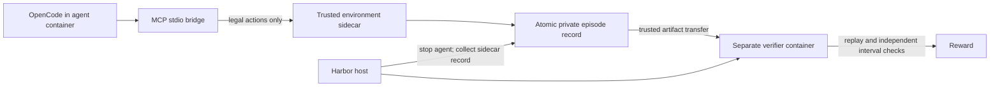

# Harness integration and trust boundary

## Status and versions

The team supplied [Harbor](https://github.com/laude-institute/harbor), which redirects
to `harbor-framework/harbor`. It is the framework, not the event-specific AfterQuery
starter kit/scoring skeleton. **Official AfterQuery compatibility remains unverified.**
The first model identifier and credentials have not been supplied to this build.

Pinned candidate: Harbor 0.26.0, MCP SDK 2.3.0, OpenCode 1.19.5, OR-Tools 9.15.6755,
Python 3.12. Upstream inspected at `3cb627394b95d3ae605f31e0d694edf508cf4b7b`.
The lockfile records transitive packages; the agent image requirements are exported
with hashes from it. The Python container uses a multi-platform image digest.
OpenCode's installer still needs network access; Debian utility packages and
provider/model availability are external runtime dependencies.

## Architecture

- Main container receives the bridge, public instance and planning libraries. It
  receives no generator witness, live state files, verifier code, Docker socket
  or shared writable state volume. Solver libraries are available to the agent.
- One service/container state per Harbor trial. The service is HTTP with four
  legal operations; it has no reset, filesystem, arbitrary code or reward API.
  Raw HTTP calls obey the same checks as MCP calls.
- The sidecar atomically persists each mutating action before replying. Its
  collection hook checks health, freezes the last record after the agent phase,
  and writes `/state/episode.json` in the sidecar.
- Harbor declares that artifact's service as `environment`, collects it through
  the host, then places it in a fresh verifier container. Agent convention
  artifacts go to a different path and are never used for scoring.
- Verifier code and expected instance come from the task's `tests` image, never
  the agent workspace. It replays all transitions and separately checks
  prerequisites, resource intervals, completion times and objective value.
- Missing records, failed collection, invalid records and mismatched rewards
  are infrastructure failures. They produce no authoritative zero-score result.
- Agent timeouts keep completed-work credit; reports label them interrupted.
  Provider rate limits and other infrastructure failures are retained separately.

This is the intended container boundary; schema and local transport tests alone
are not an adversarial proof. GitHub's Docker smoke tests the runtime path. Finish
with the event's 15-minute shell/file/protocol exploit session before submission.

## Commands

See README for `scripts/judge.sh`. `--smoke` runs the legal reference without model
keys. Full mode runs reference, three OpenCode attempts, do-nothing and stop-early.
`--seeds 0 1 2 3 4` is development; `--seeds 100 101 102` is reserved for after freeze.
Do not enter API keys in arguments: Harbor resolves provider credentials from the
calling environment. `--credential-env` names a required variable; it does not
change Harbor's provider mapping. Confirm that mapping for the event provider.

Each invocation needs a new output directory. Results preserve commands, code SHA
and dirty flag, instance/hash, seed, model, harness and agent version, action/time
limits, scores, status, full record and raw Harbor trace paths. Reports show each
attempt, variance, missed deadlines and timings. Check `cleanup_unconfirmed` after
an interrupted wrapper; inspect the provider and remove leftover resources if set.
Native Harbor deletes trial environments by default; no automatic model retries.

Core/reference checks need no model credentials. Frontier judging requires the
event-approved model access. A private team Modal account is never required for
the local Docker judge path.

## Modal compatibility gate

Use native `harbor run --env modal`, CPU only. No custom scheduler or GPU.
Run one reference smoke before a full suite (three concurrent frontier attempts).
Timebox event-kit compatibility to 45 minutes. Both service collection and separate
verification must work; fail closed if either is unsupported. If blocked, retain
the Docker judge path and defer Modal. Do not replace trusted evidence with an
agent-written file to make a cloud demo work.

Current workstation lacks Docker, Modal configuration and frontier credentials.
No local/cloud equality or cloud performance result has been claimed. Replay
identical actions locally and in Modal before claiming equality; stochastic
frontier responses need not match. Report batch time including cold startup,
rate limits, failed trials and provider cleanup.

## Required event handoff

1. Obtain exact event kit/scoring skeleton/submission layout and approved model ID.
2. Run its unchanged example and record version, command, credentials variable names.
3. Confirm tool naming/transport, strict invalid-action behavior, timeout handling
   and trusted record transfer; adapt only the boundary if necessary.
4. Exercise the judge wrapper through that kit and record evidence.
5. Run repeated held-out frontier evaluations and explain observed decisions.

Sources inspected: [multi-container](https://docs.harborframework.com/tasks/multi-container),
[separate verifier](https://docs.harborframework.com/tasks/separate-verifier),
[task artifacts](https://docs.harborframework.com/tasks/artifacts),
[Modal Harbor example](https://modal.com/docs/examples/harbor_evals).
The Modal example's older Harbor pin is not used: this task depends on 0.26's
trusted sidecar collection. Installed source/schema validation takes precedence
when an example targets a different version.
