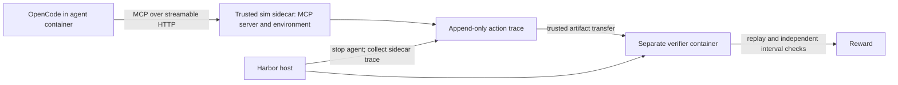

# Harness integration and trust boundary

## Status and versions

The team supplied [Harbor](https://github.com/laude-institute/harbor), which redirects
to `harbor-framework/harbor`. It is the framework, not the event-specific AfterQuery
starter kit/scoring skeleton. **Official AfterQuery compatibility remains unverified.**
The first model identifier and credentials have not been supplied to this build.

Pinned candidate: Harbor 0.26.0, MCP SDK 2.3.0, OpenCode 1.19.5, OR-Tools 9.15.6755,
Python 3.12. Upstream inspected at `3cb627394b95d3ae605f31e0d694edf508cf4b7b`.
The lockfile records transitive packages; the agent image requirements are exported
with hashes from it. The Python container uses a multi-platform image digest.
OpenCode's installer still needs network access; Debian utility packages and
provider/model availability are external runtime dependencies.

## Architecture

The backend that implements this boundary is `src/envkit`; see [BACKEND](BACKEND.md).

- Main container receives planning libraries only. It receives no scenario,
  seed, engine code, generator witness, live state files, verifier code, Docker
  socket or shared writable state volume. The public instance comes from
  `observe`. Solver libraries are available to the agent.
- One sidecar and one episode per Harbor trial. The sidecar serves MCP with the
  four legal tools; it has no reset, filesystem, arbitrary code or reward route.
  Raw HTTP calls to the MCP endpoint obey the same checks as an MCP client's.
- The sidecar appends each call to `/var/lib/envkit/trace.jsonl` and syncs it
  before replying. If the sidecar restarts it rebuilds its state from that file.
- Harbor declares that artifact's service as `sim`, collects it through the
  host after stopping the agent, then places it in a fresh verifier container.
  Agent convention artifacts go to a different path and are never used for scoring.
- Verifier code, scenario and seed come from the task's `tests` image, never
  the agent workspace. It replays all calls, finalizes the episode (an agent
  that stopped is recorded as `harness_interruption`), and separately checks
  prerequisites, resource intervals, completion times and objective value.
- A missing trace, failed collection or a replay that cannot be graded writes
  no reward and exits non-zero. These are infrastructure failures. They produce
  no authoritative zero-score result. Reports also treat a trace that does not
  reproduce on replay, or a Harbor reward that differs from the verifier's, as
  infrastructure failures.
- Agent timeouts keep completed-work credit; reports label them interrupted.
  Provider rate limits and other infrastructure failures are retained separately.

This is the intended container boundary; schema and local transport tests alone
are not an adversarial proof. The [Docker smoke that passed in CI](https://github.com/rmuthukumar23/junction/actions/runs/43537261501)
ran the previous adapter, before the backend merge; see EXPERIMENTS for what has
been run on the current path. Finish with the event's 15-minute
shell/file/protocol exploit session before submission.

## Commands

See README for `scripts/judge.sh`, which runs `envkit eval --scenario shift-planner`.
`--smoke` runs the legal reference without model keys. Without `--model` it runs
reference, do-nothing and stop-early. Full mode adds three OpenCode attempts.
Each scripted run must reproduce its calibrated score exactly.
`--seeds 0 1 2 3 4` is development; `--seeds 100 101 102` is reserved for after freeze.
Do not enter API keys in arguments: Harbor resolves provider credentials from the
calling environment. `--credential-env` names a required variable; it does not
change Harbor's provider mapping. Confirm that mapping for the event provider.

Each invocation needs a new output directory. Results preserve commands, code SHA
and dirty flag, scenario, bundle hash, seed, model, harness and agent version,
scores, status, the tasks that were run and raw Harbor trial paths, which hold
the full trace and the verifier's score.json (instance hash and per-job outcomes). Reports show each
attempt, variance, missed deadlines and timings. Check `cleanup_unconfirmed` after
an interrupted wrapper; inspect the provider and remove leftover resources if set.
Native Harbor deletes trial environments by default; no automatic model retries.

Core/reference checks need no model credentials. Frontier judging requires the
event-approved model access. A private team Modal account is never required for
the local judge path. `--backend podman` works where Docker is absent; it needs
a compose frontend (`podman compose` or `podman-compose`).

## Modal compatibility gate

Use native `harbor run --env modal`, CPU only. No custom scheduler or GPU.
Harbor's multi-container example states that Compose sidecars are not supported
on cloud providers, so expect this gate to fail until Harbor says otherwise.
Run one reference smoke before a full suite (three concurrent frontier attempts).
Timebox event-kit compatibility to 45 minutes. Both service collection and separate
verification must work; fail closed if either is unsupported. If blocked, retain
the Docker judge path and defer Modal. Do not replace trusted evidence with an
agent-written file to make a cloud demo work.

Current workstation lacks Docker, Modal configuration and frontier credentials.
No local/cloud equality or cloud performance result has been claimed. Replay
identical actions locally and in Modal before claiming equality; stochastic
frontier responses need not match. Report batch time including cold startup,
rate limits, failed trials and provider cleanup.

## Required event handoff

1. Obtain exact event kit/scoring skeleton/submission layout and approved model ID.
2. Run its unchanged example and record version, command, credentials variable names.
3. Confirm tool naming/transport, strict invalid-action behavior, timeout handling
   and trusted record transfer; adapt only the boundary if necessary.
4. Exercise the judge wrapper through that kit and record evidence.
5. Run repeated held-out frontier evaluations and explain observed decisions.

Sources inspected: [multi-container](https://docs.harborframework.com/tasks/multi-container),
[separate verifier](https://docs.harborframework.com/tasks/separate-verifier),
[task artifacts](https://docs.harborframework.com/tasks/artifacts),
[Modal Harbor example](https://modal.com/docs/examples/harbor_evals).
The Modal example's older Harbor pin is not used: this task depends on 0.26's
trusted sidecar collection. Installed source/schema validation takes precedence
when an example targets a different version.
